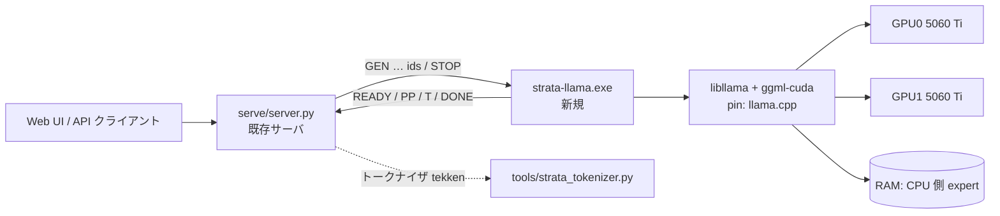

# NVIDIA-Nemotron-3.5-Super-VL-120B-A12B (UD-IQ3_XXS) 対応 実装計画書

> ## 改訂 2026-11-10(ユーザー決定の反映)
> - 対象は Nemotron-3.5-Super-VL に確定(Muse-Spark はコピーミス)。
> - **方式は A(Strata 自前エンジン)に変更**。expert キャッシュ、CPU expert プール、MTP を含める。画像(mmproj)も対象。以降の本文中の「方式 B(`strata-llama`)」は、**実機が使えるまでの参照オラクル/検証用**の位置づけに下げる(実装しない可能性あり)。
> - 環境: VS 2022 Build Tools 導入済み(`vcvars64.bat` で `cl` 19.44 を確認)、CUDA 13.1 の `nvcc` を確認、Python は `<checkout>\.venv`(cmake / ninja / regex / pytest 等)。大きなファイルは `D:` のプロジェクト配下に置いてよい。
> - 検証方針: モデルのロードを伴う検証と長時間の GPU 実行は行わず、**まとめてユーザーに依頼**する。数秒・数十 MB 規模の合成テンソルによるカーネル単体テストは GPU で実行してよい(承認済み)。
> - 実装順: (a) tekken トークナイザ → (b) C++ 系統登録(GGUF 読み取り・レイアウト検証) → (c) CPU 参照実装 → (d) CUDA カーネル → (e) 配置・MTP・画像 → (f) サーバ/ランチャー登録。進捗は `docs/NEMOTRON35_PROGRESS.md` に記録する。

作成日: 2026-11-10 / 状態: 計画のみ(コードは未変更) / 対象リポジトリ: `<checkout>`(Strata 0.2.13, engine 0.1.59)

---

## 0. 要約(先に結論)

| 項目 | 内容 |
| --- | --- |
| 対象モデル | **`nemotron_h_moe`** = NVIDIA-Nemotron-3.5-Super-VL-120B-A12B の Unsloth `UD-IQ3_XXS`(3分割、計 55.65 GiB)。 |
| 重要な前提の訂正 | 依頼文の「unsloth/Muse-Spark-Open-816B-A42B-GGUF の UD-IQ3_XXS」は、**この PC では物理的に動かせない**(下の 1 章)。モデルファイルの保存先も Nemotron なので、**Nemotron を対象として計画した**。違っていれば知らせてほしい。 |
| 現状 | Strata は「汎用エンジン」ではなく、モデル系統ごとの手書きエンジン(Qwen3.8 / Qwen3.6 / DeepSeek V4.1)。`nemotron_h_moe` は **どこにも登録されていない**(コード全体で `nemotron` / `mamba` が 0 件)。設定だけでは動かない。 |
| 最低限必要なもの | (A) `nemotron_h_moe` を実行できるエンジン、(B) `tekken` トークナイザ、(C) サーバと設定の系統登録、(D) 2GPU+RAM の配置、の4点。 |
| 推奨方式 | **方式 B: `strata-llama`(llama.cpp の libllama を使い、Strata のエンジンプロトコルを話す薄い実行ファイル)を新設**。サーバ・API・UI・ツール呼び出し・思考表示は既存のものをそのまま使う。 |
| 「同様に動く」の範囲 | 方式 B で得られるのは **使い方・API・UI・ツール呼び出しの同等性**。Strata 固有の速度技術(適応 expert キャッシュ、AVX の CPU expert プール、MTP、prompt lookup)は **含まれない**。それを Nemotron にも入れるには別途「方式 A: 自前エンジン」(大規模、後続フェーズ)が必要。 |
| 作業規模(目安・未実績の見積もり) | 方式 B の最低ライン(M0〜M3)で約 11〜16 人日(7 章のマイルストーン合計)。方式 A(ネイティブ)は別計画で、桁違いに大きい。 |
| 今回の制約 | 他の GPU ジョブが 2 枚とも VRAM をほぼ使用中(確認済み)。**この計画の実行中、承認なしにモデルをロードする検証は行わない**。GPU を使う検証は 9 章の「承認ゲート」に分離した。 |

---

## 1. 前提の確認: Muse-Spark と Nemotron の食い違い

| | Muse-Spark-Open-816B-A42B | Nemotron-3.5-Super-VL-120B-A12B |
| --- | --- | --- |
| 総/活性パラメータ | 816B / 42B | 120B / 12B |
| 公開されている最小級の GGUF | `UD-IQ2_XXS` が 225.6 GB(6 分割)という報告あり([bloomery#684](https://github.com/midagedev/bloomery/issues/684)) | `UD-IQ3_XXS` が 55.65 GiB(実ファイルで確認) |
| `UD-IQ3_XXS` の推定 | IQ2_XXS より大きいので **225 GB を超える** | 55.65 GiB |
| この PC(RAM 約 96 GB + VRAM 2×16 GB = 約 128 GB) | **入らない**(mmap で SSD から読む運用でも、expert 全域を毎トークン読むため実用速度にならない) | **入る** |
| ローカルに置いてあるファイル | なし | `<data folder>\models\NVIDIA-Nemotron-3.5-Super-VL-120B-A12B-GGUF\UD-IQ3_XXS\` |

したがって以降は Nemotron-3.5-Super-VL を対象にする。Muse-Spark(Meta の別アーキテクチャ)が本当に必要なら別計画になる。

---

## 2. 実行環境と制約(調査で確認した事実)

| 項目 | 確認結果 |
| --- | --- |
| GPU | RTX 5060 Ti 16 GB × 2(compute capability 12.0 = sm_120) |
| **GPU の現在の使用量** | GPU0: 14,989 MiB / 16,311 MiB 使用中、GPU1: 15,550 MiB 使用中(`nvidia-smi`、他ジョブ)。**空きは各 1 GB 前後**。モデルを載せる検証は、ジョブ終了後でないと不可能。 |
| CPU / RAM | Ryzen 7 5700X(8C/16T、AVX2。AVX-512 なし)、RAM 95.9 GB |
| ストレージ | D:(HDD)空き 799.7 GB、E:(M.2 SSD)空き **25.4 GB**。2 GB 超の作業ファイルは `<work folder>\` に置く(このフォルダは作成済み)。 |
| CUDA | CUDA_PATH = v13.1。v13.2 / v12.8 なども導入済み。**`setup.py` は CUDA 13.2.0 / 13.2.1 の nvcc が sm_120 で壊れた出力を出すと記録している**(issue #892 / #968)ので、13.1 を使う。 |
| ビルド環境 | **Visual Studio が登録されていない**(`vswhere` が空)。`cmake` / `ninja` / `cl` も PATH に無い。Python 3.12.10 はある。→ 方式 B の C++ ビルドには MSVC(VS 2022 Build Tools)の導入が必要。**未導入なので M0 で確認し、導入前にユーザーに許可を取る**。 |
| 既存 llama.cpp チェックアウト | 見つからなかった。`setup.py` の `get_llama_cpp()` が pin(`3cf03257…`、2026-09-20)の zip を取得する仕組みはある。 |
| コンテキスト | 128K(131072)と 256K(262144)。`setup.py` の `CONTEXTS` にも `strata_cli/launch/settings.py` の `FALLBACK_CONTEXTS` にも両方あり、**256K を止める箇所は Strata 側に無い**。Nemotron の学習長は 1,048,576 なので rope scaling は不要。 |

---

## 3. モデルの実測仕様(GGUF ヘッダのみ読んで確認)

> 方法: 先頭シャード(約 10 MB、メタデータだけでテンソル本体を含まない)と、シャード 2・3 の**テンソル情報ヘッダ**だけをバイナリ解析した。重みデータは読んでいない。モデルのロードはしていない。解析に使った一時スクリプトは削除済み(必要なら WP0 で `tools/gguf_reader.py` を使って再現できる)。

### 3.1 アーキテクチャ

| キー | 値 | 意味 |
| --- | --- | --- |
| `general.architecture` | `nemotron_h_moe` | llama.cpp の既存アーキテクチャ(pin 時点の `llama-arch.cpp` に存在することを確認済み) |
| `block_count` | 89 | 本体 88 層 + MTP 1 層(`nextn_predict_layers = 1`、`blk.88.nextn.*`) |
| 層の並び(テンソルから判定) | `M E M E M E M A E …`(M=Mamba2, E=MoE, A=Attention) | 本体 88 層 = **Mamba2 40 + MoE 40 + Attention 8**。MTP 層(88)は Attention + MoE |
| `embedding_length` | 4096 | |
| Attention | 32 ヘッド、**KV ヘッド 2**、head 128 | Attention 層は 8 つだけ → **KV キャッシュが非常に小さい** |
| Mamba2 | `ssm.state_size=128`, `group_count=8`, `inner_size=8192`, `time_step_rank=128`, `conv_kernel=4` | ヘッド 128 × 幅 64。conv チャネル 10240 |
| MoE | **512 expert、top-22**、`expert_feed_forward_length=2688`、共有 expert 5376、`moe_latent_size=1024`(**LatentMoE**)、sigmoid ルータ + `exp_probs_b` バイアス、重み正規化 + スケール 5.0 | expert は up/down の 2 枚だけ(**ゲート無し**、活性化は relu²)。入出力は 4096→1024→(expert)→1024→4096 |
| 語彙 | 131072、`tokenizer.ggml.model = gpt2`、**`pre = tekken`**、`eos_token_id = 11`、`add_bos_token = False` | 4.3 と 6.4 を参照 |
| チャットテンプレート | `<|im_start|>`/`<|im_end|>`、`enable_thinking`(既定 True)、生成プロンプトは `<|im_start|>assistant\n<think>\n`、ツール呼び出しは `<tool_call><function=…><parameter=…>`(Qwen3-Coder と同形式) | Strata の既存 XML 形式パーサと同じ形 |
| サンプリング既定(GGUF) | temperature 1.0、top_p 0.95 | モデルカード: テキスト 1.0 / 0.95、画像 0.6 / 0.95 |

### 3.2 テンソルの種類とサイズ(重み 51.6 GiB + Q2_0 の 11 枚 ≈ 4 GiB = 約 55.65 GiB)

| 区分 | 量子化 | サイズ(GiB) |
| --- | --- | ---: |
| 全 MoE 層の expert `ffn_up_exps`(41 枚) | IQ3_XXS ×25、IQ4_XS ×8、IQ2_XS ×4、IQ2_S ×3、Q8_0 ×1 | 22.3 |
| 全 MoE 層の expert `ffn_down_exps`(41 枚) | IQ4_NL ×29、**Q2_0(型 42) ×11**、Q8_0 ×1 | 約 26.9 |
| Mamba2 `ssm_in` / `ssm_out`(40 層) | Q6_K | 2.32 / 1.03 |
| Attention q/k/v/o(9 層) | Q6_K / Q5_K / Q8_0 | 約 0.25 |
| 共有 expert(41 層) | Q4_K / Q5_K / Q6_K / Q8_0 | 約 1.22 |
| ルータ `ffn_gate_inp`(41 層) | F32 | 0.32 |
| latent 射影 up/down | Q8_0 | 0.34 |
| `output.weight` / `token_embd.weight` | Q8_0 / Q6_K | 0.53 / 0.41 |
| **expert 合計 ≈ 49.2 GiB、expert 以外 ≈ 6.4 GiB** | | **約 55.65 GiB** |

- expert は **1 MoE 層あたり約 1.2 GiB**(40 層 + MTP 層)。
- 使われている型はすべて、Strata が同梱する `third_party/strata-ggml` の MMQ インスタンス一覧(Q2_0、IQ2_XS/S、IQ3_XXS、IQ4_NL/XS、Q5_K、Q6_K、Q8_0)に含まれる。ただし方式 B では llama.cpp 自身の ggml を使うので、この一覧は直接は関係しない(方式 A に進むときの材料)。

### 3.3 メモリ見積もり(**未測定の推定**。GPU が空いたら M2 で実測して置き換える)

- **KV キャッシュ**(fp16、Attention 8 層、K+V で 1 トークンあたり 8 KiB): **128K = 1 GiB、256K = 2 GiB**。Mamba2 の状態はコンテキストに依らず約 0.16 GiB(1 本の会話あたり)。→ 128K/256K の違いは VRAM にほとんど響かない。
- **GPU に常駐させるもの**(全層ぶん): Mamba2 / Attention / 共有 expert / ルータ / latent / output / 正規化 ≈ 6 GiB。
- **VRAM 配分の目安**(2 枚とも空いた場合、各 15.5 GiB 使用可と仮定): 32 GiB − CUDA コンテキスト・計算バッファ・KV 等 ≈ 5 GiB → 重み用 約 26 GiB → expert に回せるのは 約 20 GiB = **約 16〜17 層ぶん(約 40%)**。残り 約 29 GiB の expert は **RAM** に置き、CPU が計算する。
- **RAM**: 約 29 GiB(expert)+ 会話チェックポイント(後述、数 GiB)+ OS・Python。96 GB に対して十分余裕がある。
- **速度の見込み**: expert の約 60% を DDR4 RAM(Ryzen 5700X の帯域)から読むため、デコードは **1 桁台後半〜十数 tok/s のオーダー**と推測する(**根拠となる測定はまだ無い**。Strata の docs のルール通り、測定するまで数値として約束しない)。

---

## 4. 現行実装の調査結果

### 4.1 Strata の構造(docs/HOW_IT_WORKS.md, AGENTS.md, docs/MODELS.md, docs/QWEN36.md, docs/MULTI_GPU.md)

- Strata は 3 部構成: アプリ(Tauri + Node + Web UI)/ Terminal(`strata`)/ **エンジン+サーバ**(`src/` の C++/CUDA、`serve/` の Python)。
- エンジンは **系統ごとに別実装**:
  - Qwen3.8-Flash-Next(`qwen4exp`): `src/core`, `src/prefill`, `src/kernels`, `src/program/generate.cpp`
  - Qwen3.6-35B-A3B(`qwen35moe`): `src/qwen35/q36_engine.cu`(`strata-q36`)
  - DeepSeek V4.1: 別エンジン `strata-dsv41`(`src/dsv41`、別パッケージ配布)
- **系統は GGUF の `general.architecture` のホワイトリスト**: `include/strata/artifact/model_family.hpp` の `ModelFamily { Unknown, Qwen4Exp, Qwen35Moe }`。それ以外は `Unknown` で拒否される。層ごとのテンソル表も `include/strata/core/family_layout.hpp` に決め打ち(Nemotron のテンソル `ssm_in`、`ssm_a`、`ssm_d`、`ssm_dt`、`ffn_latent_*`、`exp_probs_b` 等は未定義)。
- Qwen3.6 の経路は expert 数・top-k・層数は可変だが、**GDN(Gated DeltaNet)、M-RoPE、ゲート付き SwiGLU expert、シグモイド共有 expert、MTP の前提**が入っている。Mamba2 の SSD スキャンや relu² の非ゲート expert、LatentMoE の射影はコードが無い。再利用できるのは「GGUF リーダー」「hybrid expert 配置(VRAM/RAM)」「CPU expert プールの設計」「量子化カーネル(MMQ/MMVQ)」「サンプラとプロトコル」の部分。
- マルチ GPU のレイヤー分割は Flash-Next 経路の機能。**Qwen3.6 経路は単一デバイスに見える**(調査で `q36_engine.cu` に `cudaSetDevice` / レイヤー分割のコードが見つからなかった。全文を精読したわけではない)。`src/split`(sFNX)は Linux 専用 + Qwen3.8 専用で使えない。→ 自前エンジンで 2GPU を使うなら新規実装になる。
- `third_party/strata-ggml` は ggml の一部のみ(MMQ カーネル、CPU バックエンド)。**ggml-cuda の `ssm_scan`/`ssm_conv` は無く、llama.cpp 本体(`llama-*.cpp`, `nemotron-h` のグラフ)も同梱されていない**。ただし `tools/vision/CMakeLists.txt` は llama.cpp 本体を `add_subdirectory` して CUDA 付きでビルドする前例(pin = `LLAMA_CPP_COMMIT`)。
- llama.cpp を外部プロセスとして起動・中継する既存モードは無い(`docs/LLAMA_SWAP.md` は逆向きで、Strata を llama-swap の配下に置く話)。

### 4.2 サーバとエンジンのプロトコル(`serve/server.py`, `src/qwen35/q36_engine.cu`)

エンジンは `exe --serve <args…>` で起動され、標準入出力の行プロトコルで話す(別エンジンでも同じ):

| 方向 | 行 | 備考 |
| --- | --- | --- |
| E→S | `INFO k=v …`(任意)、**`READY <ctx> stop`**(必須) | `<ctx>` が最大コンテキスト。`stop` を付けると STOP を受ける宣言 |
| S→E | `GEN <max_new> [key=value …] <id,id,…>` | キー: `temperature top_p top_k min_p penalty_repeat penalty_freq penalty_present penalty_last_n seed logprobs allowed …`。**サンプリングはエンジン側で行う**。未知キーは無視してよい。キー列は `=` を含まない最初のトークン(ID 列)で終わる |
| S→E | `STOP` | 別スレッドで読み、生成中・プロンプト処理中どちらでも止める |
| E→S | `PP <done> <total> <ms> <tok/s>` | プロンプト処理の進捗。**無音が続くとサーバが「エンジン停止」と判断して殺すので必須級**(`PP_FLOOR_TOK_S=50` 基準の無音許容) |
| E→S | `T <id>` | 1 トークンごとに flush。EOS も `T` で出す(サーバが停止 ID を判定) |
| E→S | `DONE <generated> <prompt_tokens> <prompt_ms> <decode_ms> <finish>[…]` | `finish` は `stop`/`length`/`cancel`。**STOP 後も必ず DONE を返す** |
| E→S | `ERR <msg>` | 失敗。`ERR fatal GPU error:` は「エンジン死亡」扱い |

- **会話キャッシュ(RESUME)はサーバの必須要件ではない**。毎回プロンプト全体を読み直しても正しく動く(遅くなるだけ)。ただし本計画では 128K〜256K の長い会話を扱うので、毎回の全読み直しは実用上つらい(下の 6.2 で扱う)。
- 起動時 `READY` の待機上限は既定 900 秒(`STRATA_ENGINE_READY_S`)。56 GB のモデルロードには十分。
- 未知のコマンドライン引数(`--vision` `--layer-split` `--batch` 等)をサーバが足すことがあるので、**エンジンは未知の `--x [値]` を警告して読み飛ばす**必要がある(q36 と同じ作法)。
- 設定の `exe` に絶対パスを書けば、その実行ファイルがそのまま起動される(検証・マニフェスト不要)。`lib_dirs` は PATH に前置される(Windows)。

### 4.3 トークナイザとテンプレート

- サーバは自前の純 Python BPE(`tools/strata_tokenizer.py`)を使う。設定の `tokenizer` は `vocab.json / merges.txt / token_type.json / tokenizer.json`(Strata 独自の小さな設定)を含むフォルダ。GGUF から `tools/strata_tokenizer.py --gguf … --out …` で生成され、`chat_template.jinja` も GGUF から抽出される。
- **ブロッカー**: `pre_tokenizer_kind()` は `qwen35` と `deepseek*` しか知らず、**`tekken`(Nemotron)は `UnknownPreTokenizer` で意図的に拒否**される(誤った分割での暗黙の劣化を防ぐ設計)。→ `tekken` の正規表現を **llama.cpp とバイト一致**で追加する必要がある。
  - llama.cpp(pin 時点)の `tekken` は、正規表現だけでなく **`ignore_merges = true`**(pre-token 全体が語彙にあれば BPE マージせずそのトークンを使う)と `clean_spaces = false` を設定している。Strata の Python 実装には `ignore_merges` が無いので、これも追加が必要。
  - 正規表現(pin の `llama-vocab.cpp` より。WP1 で実装):  
    `[^\r\n\p{L}\p{N}]?((?=[\p{L}])([^a-z]))*((?=[\p{L}])([^A-Z]))+|[^\r\n\p{L}\p{N}]?((?=[\p{L}])([^a-z]))+((?=[\p{L}])([^A-Z]))*|\p{N}| ?[^\s\p{L}\p{N}]+[\r\n/]*|\s*[\r\n]+|\s+(?!\S)|\s+`
- 停止 ID: `end_token_ids()` が `<|im_end|>`(Nemotron では ID 11 = 1 トークン)を拾うので Qwen と同じ扱いで動く見込み(**ID 11 が `<|im_end|>` であることは語彙を読んで M1 で確認**)。
- 思考表示: テンプレートの生成プロンプトが `<think>\n` で終わる点は Qwen3 系と同じ。`enable_thinking` を `chat_template_kwargs` で渡す仕組みも既存。ツール呼び出しも `serve/toolformat.py` の XML 形式に該当。→ 新規パーサは不要の見込み(**M3 で回帰テスト**)。
- モデル名・サンプリング既定: `serve/server.py` の `FAMILY_MODEL_NAMES` と `MODEL_CARD_SAMPLING` に Nemotron の行が無い。無いと既定は Flash-Next 名・サンプリング既定なし。→ 追加する。

---

## 5. ギャップ分析(「Qwen3.8 / DeepSeek 同様に動く」の最低条件)

| # | 条件 | 現状 | 必要な対応 | 方式 B での扱い |
| --- | --- | --- | --- | --- |
| R1 | `nemotron_h_moe` を計算するエンジン | 無い(Mamba2 / LatentMoE / relu² expert / ルータバイアス すべて未実装) | 新規エンジン | **libllama(llama.cpp 本体)をそのまま使う** |
| R2 | サーバが話せるエンジン(READY/GEN/T/PP/DONE/STOP) | 他系統のみ | プロトコル実装 | `strata-llama` で実装(6.1) |
| R3 | `tekken` トークナイザ | 拒否される | 正規表現 + `ignore_merges` | 6.4 / WP1 |
| R4 | 系統登録(設定、モデル名、サンプリング既定、arch 判定) | 無い | `serve/server.py` 他 | 6.5 |
| R5 | 2 GPU + RAM への配置、128K/256K | Qwen3.6 経路は単一 GPU | 配置ロジック | llama.cpp のテンソル配置(`tensor_split` / expert の CPU 上書き)を使い、起動時に空き VRAM から決める(6.3) |
| R6 | 長い会話の前方再利用(再読み込み回避) | エンジン側の責務 | チェックポイント | Mamba2 状態は巻き戻せないため、**チェックポイント方式**(6.2) |
| R7 | Windows でのビルドと配布 | 主エンジン用の Windows ビルドスクリプトは無い(`setup.py` が行う) | `strata-llama` のビルド手順 | `tools/vision` と同じ作法で CMake プロジェクト化(6.1) |
| R8 | 画像(mmproj BF16 1.6 GB) | `strata-vision`(mtmd)は Qwen 用の読み方 | C-RADIO 射影の対応可否は未確認 | **最低ラインでは対象外**(`--vision off`)。後続フェーズ |
| R9 | MTP(投機的デコード) | Qwen3.x の MTP 前提 | — | 最低ラインでは対象外 |

### 方式の比較

| | A. 自前エンジン(`src/nemotron`、q36 流) | **B. libllama アダプタ `strata-llama`(推奨)** | C. 既製 `llama-server` を Python で中継 |
| --- | --- | --- | --- |
| 内容 | Mamba2 SSD スキャン/畳み込み、relu² の非ゲート expert、LatentMoE、ルータバイアス、Attention、2GPU レイヤー分割、状態の保存/復元、Windows ビルドをすべて新規実装 | llama.cpp の `nemotron_h_moe`(pin に存在)で計算し、行プロトコルだけ Strata 側に合わせる | HTTP の llama-server を起動し、Python の薄いシムがプロトコルに変換 |
| 速度技術 | Strata の expert キャッシュ/CPU プール等を活かせる(将来) | llama.cpp の標準機能のみ | 同左+HTTP 経由 |
| 作業量(目安) | 非常に大きい。カーネル検証が重く、GPU 検証が大量に必要 | 11〜16 人日(M0〜M3、最低ライン) | やや小さいが、バイナリ配布・停止・状態保存の制御が粗い |
| 今の制約との相性 | GPU を長時間使う検証が必須 → **今回の条件に合わない** | トークナイザ照合・プロトコル・サーバ統合は GPU もモデル重みも無しで検証できる(9.1)。計算の正しさだけが実機検証(9.2)に残る | 同左だが、停止・状態保存の制御が粗い |
| 判定 | 後続フェーズ(速度が不足した場合) | **採用** | 検証用の参照(オラクル)としてだけ使う |

**方式 B の利点**: pin の llama.cpp(2026-09-20)に `LLM_ARCH_NEMOTRON_H_MOE`、`moe_latent_size`、`nextn_predict_layers`、ハイブリッド(再帰状態)対応が入っていることを確認した。`tools/vision` が同じ pin の llama.cpp を CUDA 付きでビルドする前例がある。

**方式 B の限界(正直に)**: Strata 固有の高速化は入らない。速度は「llama.cpp 標準の部分 GPU オフロード」相当になる。速度が不足する場合のみ方式 A を検討する。

---

## 6. 設計(方式 B)

### 6.1 `strata-llama` の仕様(新規 `tools/llama_engine/`)

- 作り: `tools/vision/CMakeLists.txt` と同じ独立プロジェクト。`LLAMA_DIR` に pin の llama.cpp を指定し、`GGML_CUDA=ON`、`CMAKE_CUDA_ARCHITECTURES=120`、`GGML_BACKEND_DL=OFF`、MSVC では UTF-8 マニフェストを付与。出力は `strata-llama.exe`。
- 起動引数(受け付けるもの): `--serve`、`--native <GGUF 先頭シャード>`、`--max-context N`、`--gpu-split a,b`(任意)、`--expert-gpu-layers LIST`(任意、6.3)、`--threads N`、`--kv f16|q8_0`、`--ubatch N`、`--families`(`qwen4exp nemotron_h_moe` を出力: `setup.py` の `engine_families` との互換)、`--tokenize`(語彙のみロード、6.4)。**未知の `--x [値]` は stderr に警告して読み飛ばす**。
- モデルロード: `llama_model_params`(`n_gpu_layers`=全層、`split_mode=LAYER`、`tensor_split`、`main_gpu`、`use_mmap=true`、**expert テンソルの CPU 上書き**=`-ot` 相当)、`llama_context_params`(`n_ctx`=設定値、`n_batch`/`n_ubatch`、`flash_attn` 自動、`type_k/type_v` 既定 f16)。
- プロトコル: 4.2 の表どおり。`PP` は 512〜2048 トークンのチャンクごとに出す。STOP は専用スレッドで原子フラグ化し、チャンク間・トークン間で確認する。**STOP 後も必ず `DONE … cancel` を返す**。ログは stderr、stdout はプロトコル専用。
- サンプラ: `GEN` のキーから `llama_sampler_chain`(penalties → top_k → top_p → min_p → temp → dist/greedy)を要求ごとに構築。`temperature` キーが無ければ greedy(Strata の約束)。`top_k` の上限 64 はサーバ側でクランプ済みなのでそのまま受ける。`logprobs` / `logit_bias` は最低ラインでは非対応とし、`ERR` で理由を返す(q36 が `logit_bias` を拒否するのと同じ扱い。サーバ側の拒否条件は WP3 で整える)。
- 画像(`GENI`)は非対応(`ERR this engine was started without --vision`)。MTP は未使用(`blk.88.nextn.*` は読み込むが使わない)。

### 6.2 会話の前方再利用(最低ラインに含める)

Mamba2 の再帰状態は途中の位置へ巻き戻せないので、**Attention の KV はトリムできても状態は戻せない**。llama.cpp の `llm_arch_supports_rs_rollback` に `NEMOTRON_H_MOE` が含まれることは確認したが、使える範囲は M0 でヘッダ(`llama.h`)を確認してから決める(未確認)。

- 方式: プロンプト処理中に **一定間隔(例: 4096〜8192 トークン)と末尾でチェックポイント**(`llama_state_seq_get_data`)を RAM に保存。新しい要求では、保持トークン列との最長共通接頭辞を求め、**接頭辞以下で最も近いチェックポイントへ復元**し、その位置以降だけ読む。
- 容量の目安: 状態は約 0.16 GiB + KV(8 KiB/トークン)。100K トークンで約 1 GiB → チェックポイントは**最大 3〜4 個、合計上限を設定値化**(例 6 GiB)。RAM 96 GB なら余裕。
- これが無いと、128K 級の履歴を持つエージェント会話で毎ターン全体を読み直す(PP 速度が数百 tok/s なら数分)ので、**実用上の最低ライン(M3)に含める**。M2 までは「毎回全読み直し」で機能確認だけ行う。

### 6.3 GPU/RAM への配置(2 枚の 5060 Ti)

- 常駐: 全層の Mamba2 / Attention / 共有 expert / ルータ / latent / 正規化 / output を GPU に。`token_embd` は CPU でもよい(0.41 GiB)。
- expert: 各 MoE 層の `ffn_up_exps` / `ffn_down_exps` を層単位で「GPU」か「CPU(RAM)」に振り分ける。**起動時の空き VRAM(`nvidia-smi` の free)から層数を決める**(今は他ジョブが占有しているため固定値にしない)。新規 `strata_control/nemotron_fit.py` に純 Python の計算を置く(3.3 の表をコード化。ユニットテストは GPU 無しで書ける)。
- 2 枚の分け方: `split_mode=LAYER`、`tensor_split` は空き VRAM 比。層分割はパイプライン的で、Strata の docs と同様「容量を増やすが速度は増えない」ことがある。NVLink/P2P は不要。
- CUDA の host 固定メモリ(WDDM)の制限: Strata の docs は WDDM でマルチ GPU のとき固定領域が 8 GiB に制限されると書いている。llama.cpp 側での挙動は未確認 → M2 で実測。
- llama.cpp に自動フィット関数(`llama_params_fit`)があるか pin の `llama.h` で未確認(取得時の検索では見つからなかった)。**M0 で確認し、無ければ上記の自前計算で `tensor_buft_overrides` を組む**。

### 6.4 トークナイザ(tekken)と検証オラクル

- `tools/strata_tokenizer.py` に `tekken` を追加: 正規表現(4.3)、`ignore_merges`(pre-token 全体が語彙にあれば直接採用)、`clean_spaces=False`、`add_bos=False`(GGUF が False を指定)。
- **正しさの検証は GPU もモデル重みも不要**: `strata-llama --tokenize` が `llama_model_load` を `vocab_only=true` で行い(シャード 1 のメタデータ約 10 MB だけで済む)、`llama_tokenize` の結果と Python 実装を、多言語・記号・数字・改行・特殊トークン・長大入力のコーパスで照合する(Strata 既存の `tools/test_strata_tokenizer.py` の作法)。

### 6.5 サーバ/設定側の最低限の変更

| ファイル | 変更 |
| --- | --- |
| `tools/strata_tokenizer.py` | `tekken` 追加、`ignore_merges`、`pre_tokenizer_kind` 更新 |
| `serve/server.py` | `FAMILY_MODEL_NAMES["nemotron_h_moe"]="nemotron-3.5-super-vl-120b-a12b"`、`MODEL_CARD_SAMPLING["nemotron_h_moe"]`(thinking/instruct とも temperature 1.0・top_p 0.95)、`arch_from_tokenizer`(`pre=="tekken"` → `nemotron_h_moe`)、`logprobs`/`logit_bias` の非対応エラー |
| 実行設定 JSON | `exe`(絶対パス)、`args`、`tokenizer`、`arch`、`model_name`、`lib_dirs`(CUDA 13.1 の `bin`)、`cwd`、`log`、`port` |
| `tools/llama_engine/make_run_config.py`(新規) | M1〜M3 用: 上の JSON を生成(GGUF パス、コンテキスト 128K/256K、空き VRAM から配置を計算) |

---

## 7. 作業項目(WP)と受け入れ基準

> 「GPU 不要」は、このセッションの制約(他ジョブ使用中・モデルロード禁止)の下でも実施できるという意味。

| WP | 内容 | 主なファイル | GPU | 受け入れ基準 |
| --- | --- | --- | :-: | --- |
| **WP0** 準備 | 開発環境の確認。VS 2022 Build Tools(C++)、`cmake`/`ninja`(pip)の導入可否をユーザーと確認。pin の llama.cpp zip を `<work folder>\llama.cpp\` に展開。`llama.h` / `llama-model.cpp` で次を確認: テンソル名(`ffn_latent_down/up`、`exp_probs_b`、`nextn.*`)、`llama_state_seq_*` と部分保存フラグ、`llama_params_fit` の有無、`rs_rollback` の使い方、層ごとの `head_count_kv` / `feed_forward_length` 配列の読み取り | `<work folder>\` | 不要 | 上記の確認結果が本書に追記され、pin を上げる必要の有無が判定されている |
| **WP1** トークナイザ | `tekken` の追加と単体テスト | `tools/strata_tokenizer.py`, `tools/test_strata_tokenizer.py` | 不要 | 既存テスト全通過+ tekken の既知ケース。WP2 完了後に llama.cpp 照合コーパスで**差分 0** |
| **WP2** `strata-llama` 骨格 | CMake、`--families`、`--tokenize`、プロトコル(READY/GEN/PP/T/DONE/STOP/ERR)、サンプラ、未知引数の読み飛ばし。モデルロードは実装するが**この段階では実行しない** | `tools/llama_engine/*` | 不要(ビルドのみ) | MSVC+CUDA 13.1 でビルド成功。`--families` と `--tokenize` が動く |
| **WP3** サーバ統合テスト | モデル不要の**スタブエンジン**(Python。同じプロトコルを話す)でサーバを起動し、チャット/ストリーム/STOP/ツール呼び出し/`enable_thinking` をテスト。`serve/server.py` の登録変更 | `serve/server.py`, `serve/test_nemotron_*.py` | 不要 | 新規テスト全通過。既存の `serve/test_*.py` に回帰なし(Qwen 系の既定動作はバイト単位で不変) |
| **WP4** 配置計算 | `nemotron_fit.py`: 空き VRAM・コンテキスト(128K/256K)・RAM から expert の GPU 層数と `tensor_split` を計算。KV/状態/チェックポイントの見積もり | `strata_control/nemotron_fit.py`, テスト | 不要 | 3.3 の表を再現するテスト。空き VRAM が足りない場合に分かりやすい理由を返す |
| **WP5** 会話チェックポイント | 6.2 の実装とユニットテスト(トークン列・最長共通接頭辞・容量上限の純ロジックは GPU 無しでテスト) | `tools/llama_engine/` | 不要(ロジック)/ 要(実機) | ロジックのテスト通過。実機での一致は 9 章の G2 |
| **WP6** 実機検証 | **承認ゲート G1〜G3**(9 章) | — | **要** | 9 章の基準 |
| **WP7** 系統登録(Qwen3.8 と同じ導線) | `setup.py` に系統エントリ(`OWN_PATH_FAMILIES` 流または `MULTI_FILE_FAMILIES` 流。3 分割と mmproj 非使用に対応)、`engine_families` の判定、`strata launch --family nemotron35 --model-path`、`strata models import` のフィンガープリント、`strata_control/feed*.py`、`gpu_fit` の見積もり、`apps/host` の `local-models.mjs` / `catalog.mjs`、`docs/MODELS.md` ほか | 多数(8 章) | 不要 | `strata launch --plan --family nemotron35 …` が計画を表示。既存系統のテストに回帰なし |
| **WP8** 画像・MTP・方式 A | 別計画 | — | — | — |

### マイルストーン

| M | 範囲 | 目安 | 得られるもの |
| --- | --- | --- | --- |
| M0 | WP0 | 1〜2 日 | ビルド環境と llama.cpp pin の事実確認 |
| M1 | WP1, WP2 | 4〜6 日 | トークナイザ一致、`strata-llama` が ビルドでき、プロトコル単体で動く |
| M2 | WP3, WP4 | 3〜4 日 | スタブエンジンでサーバ全体が通る。配置計算が完成 |
| **ゲート G1** | 実機: ロードと数トークン | 承認後 | 最初の実モデル動作 |
| M3 | WP5, G2, G3 | 3〜4 日 | 128K / 256K の動作、前方再利用、実測値 |
| M4 | WP7 | 3〜5 日 | `strata launch` / アプリからの導線、docs |

---

## 8. 変更するファイル一覧(予定)

**新規**
- `tools/llama_engine/CMakeLists.txt`, `strata_llama.cpp`(+ ヘッダ分割), `make_run_config.py`, テスト
- `strata_control/nemotron_fit.py`(+ テスト)
- `serve/test_nemotron_family.py`(スタブエンジン統合テスト)
- `docs/NEMOTRON35.md`(利用者向け。測定済みの数値だけを記載)

**変更**
- `tools/strata_tokenizer.py`, `tools/test_strata_tokenizer.py`
- `serve/server.py`(登録のみ。既存系統の既定は不変)
- M4: `setup.py`(系統エントリ、pin 定数 `LLAMA_NEMOTRON_COMMIT` を別に持つ)、`strata_control/feed.py` / `feed_models.py` / `models.py` / `gpu_fit.py`、`strata_cli/launch/*`(系統一覧、コンテキスト一覧)、`apps/host/server/local-models.mjs` / `catalog.mjs`、`docs/MODELS.md` / `AI_REFERENCE.md` / `CAPABILITIES.md` / `AGENTS.md`

**変更しないもの**: `src/` 配下の既存エンジン(CUDA/HIP/SYCL/Metal)。したがって既存バックエンドのビルド影響は無い(AGENTS.md の「新機能はオプトイン、既定経路はバイト単位で不変」に沿う)。

---

## 9. 検証計画と承認ゲート

### 9.1 今のセッション制約で実施できる検証(GPU 不要、モデル重み未ロード)

- Python: トークナイザ、サーバ登録、配置計算、チェックポイント選択ロジックの単体テスト。
- `strata-llama --tokenize`(語彙のみ)による llama.cpp との照合。
- スタブエンジンでのサーバ統合(チャット、ストリーム、STOP、ツール呼び出し、`enable_thinking`、コンテキスト上限 128K/256K の `READY` 反映)。
- GGUF ヘッダの静的確認(`tools/gguf_reader.py` 流。重みは読まない)。
- ビルドの成否(CPU のみ)。

### 9.2 GPU を使う検証(**他ジョブ終了とユーザーの明示承認の後のみ**)

| ゲート | 内容 | 実行条件 | 合格基準 |
| --- | --- | --- | --- |
| **G0** | 事前チェック(実行はしない、確認のみ) | `nvidia-smi` で両 GPU の空きが十分(各 14 GiB 以上)、RAM 空き 60 GB 以上 | 数値を記録 |
| **G1** | 128K で起動し、短いプロンプト+32 トークンを greedy 生成。同じ GGUF を**既製の llama.cpp(`llama-cli`)で同条件に走らせた結果と先頭トークンを比較** | 承認後。モデルのロードは 1 回 | 先頭 16 トークン以上が一致、`READY` に `ctx=131072`、クラッシュなし |
| **G2** | 8K〜32K プロンプトで PP/TG 速度を測定、STOP、前方再利用(同じ会話の 2 ターン目が差分のみ読むこと) | G1 合格後 | 速度の実測値を記録。2 ターン目の `prompt_read` が差分のみ |
| **G3** | **256K で起動**し、長いプロンプト(例 100K+)と実際のツール呼び出し | G2 合格後 | 起動・生成・停止が成功。VRAM/RAM の実測を 3.3 の推定と置き換える |

各ゲートの前に、実行コマンド・想定時間・想定される VRAM/RAM 使用量を提示して承認を取る。**GPU を使う長時間のベンチマークは行わない**。大きなファイルや出力(ログ・ダンプ・llama.cpp zip)は `<work folder>\` に置く。

---

## 10. リスクと未確認事項

| # | 内容 | 影響 | 対処 |
| --- | --- | --- | --- |
| 1 | **pin(2026-09-20)の llama.cpp が、この GGUF(Nemotron 3.5 は 2026-10-15 公開)を読めるか未確認**。アーキテクチャ名と `moe_latent_size` は pin にあるが、テンソル名や 3.5 固有の変更は未確認 | ロード失敗 | WP0 で `llama-model.cpp` を確認。必要なら Nemotron 用に pin を上げる(**`LLAMA_CPP_COMMIT` とは別定数**にして、`strata-vision` と既存エンジンのビルドに影響させない) |
| 2 | VS 2022 Build Tools 未導入 | ビルドできない | WP0 で導入の許可を取る。容量の大きいインストール(数 GB)なので、先に C: の空きを確認 |
| 3 | 他ジョブによる VRAM 占有 | 実機検証が遅れる | G0 で空きを確認し、占有が続く間は 9.1 の検証だけ進める |
| 4 | 状態のチェックポイントが llama.cpp のハイブリッドメモリで期待通り動くか | 会話の再利用ができない | WP0 でヘッダ確認 → WP5 の最小実装 → G2 で実測。最悪、全読み直し(正しいが遅い) |
| 5 | DDR4 帯域が制約になり、速度が期待より低い | 体感速度 | 3.3 のとおり推定は未測定。G2/G3 で実測し、docs には測定値のみ記載。不足なら方式 A を別計画で検討 |
| 6 | llama.cpp の CPU 側 expert 計算が `IQ3_XXS`/`Q2_0` 等で十分に最適化されているか | 速度 | 実測。`Q2_0`(型 42)が pin の ggml に存在することは `ggml.h` で確認済み |
| 7 | 画像(mmproj)は C-RADIO 射影の対応が pin の mtmd にあるか不明 | 画像不可 | 最低ラインでは `--vision off`。後続で調査 |
| 8 | ライセンス | 配布時の表示 | モデルは NVIDIA Open Model License 等(各モデルのライセンスが適用)。Strata は MIT、llama.cpp は MIT。docs に明記 |
| 9 | この調査自体の限界 | — | コードは読んだが**ビルドも実行もしていない**。Python/C++ のシンボルの有無の一部(上記)は WP0 で確認する。性能・メモリの数値は推定のみ |

---

## 11. 決めてほしいこと

1. 対象モデルを **Nemotron-3.5-Super-VL**(本書)で進めてよいか(Muse-Spark は 1 章の理由で別扱い)。
2. 方式 **B(libllama アダプタ)** で進めてよいか。Strata 固有の高速化は後続(方式 A)とする点も含めて。
3. **Visual Studio 2022 Build Tools の導入**を許可するか(導入先ドライブと容量を事前に提示する)。
4. 最低ラインに **画像(mmproj)を含めない**ことでよいか。
5. G1 以降の実機検証を始めてよい時期(他の GPU ジョブの終了後)。

---

## 参考にした資料

- リポジトリ内: `docs/HOW_IT_WORKS.md`, `docs/MODELS.md`, `docs/QWEN36.md`, `docs/MULTI_GPU.md`, `docs/SPLIT_ENGINE.md`, `AGENTS.md`, `serve/server.py`, `src/qwen35/q36_engine.cu`, `include/strata/artifact/*.hpp`, `include/strata/core/family_layout.hpp`, `tools/strata_tokenizer.py`, `tools/vision/CMakeLists.txt`, `setup.py`, `third_party/strata-ggml/UPSTREAM.md`
- 外部(要約して参照): [unsloth/NVIDIA-Nemotron-3.5-Super-VL-120B-A12B-GGUF](https://huggingface.co/unsloth/NVIDIA-Nemotron-3.5-Super-VL-120B-A12B-GGUF)(アーキテクチャ概要・1M コンテキスト・MTP)、[llama.cpp pin 3cf03257 の `llama-arch.cpp`](https://github.com/ggml-org/llama.cpp/blob/3cf03257f219afbe7334045ff7c6a06ac68c627d/src/llama-arch.cpp)(`nemotron_h_moe`, `moe_latent_size`, ハイブリッド/rs_rollback)、同 `llama-vocab.cpp`(`tekken` の正規表現と `ignore_merges`)、[Muse Spark Open GGUF の報告](https://github.com/midagedev/bloomery/issues/684)(サイズの根拠)
